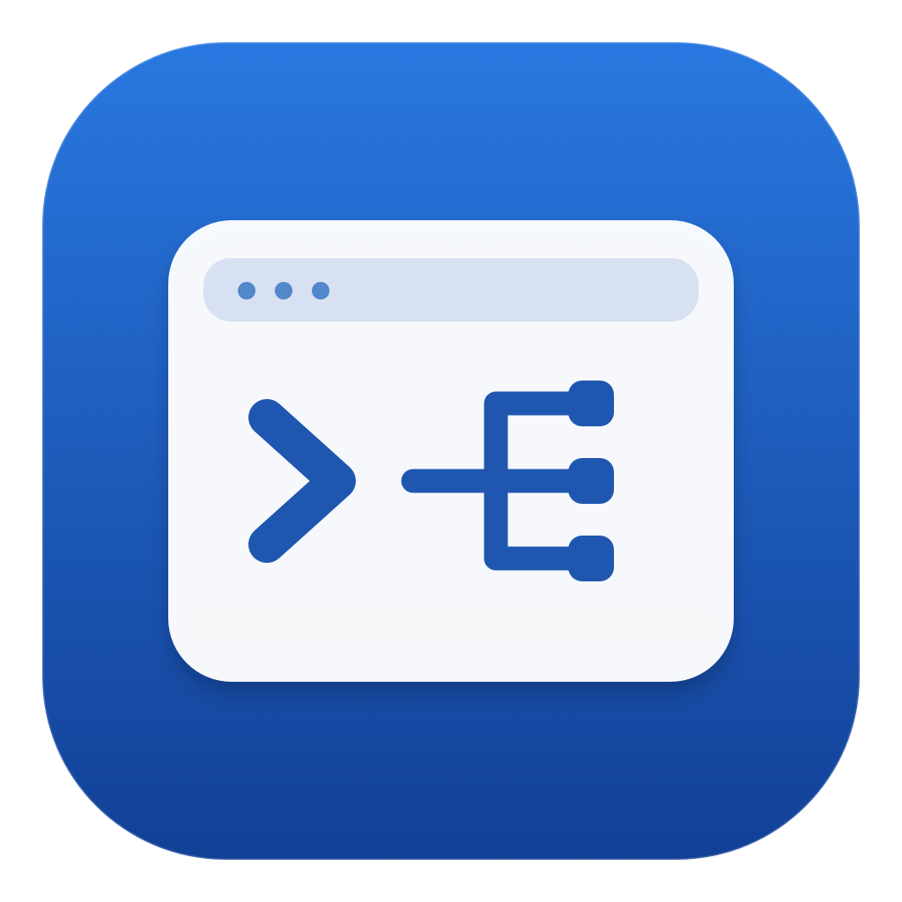

<div align="center">
  
  <h1>Shell Command Hub</h1>
  <p><strong>常用命令，一处收好。</strong></p>
  <p>macOS Shell 工具箱：媒体属性、解压整理与端口进程管理。</p>
</div>

`hub` 保留分类、搜索和说明浏览；`vinfo`、`zidy`、`pinfo` 直接进入各自的 fzf TUI。

## 开始使用

```sh
brew install fzf mediainfo
./hub doctor
./hub install
exec zsh
```

`fzf` 用于工具交互（本轮验证版本 0.74.5）；`mediainfo` 仅用于媒体属性。运行环境为 macOS 自带 zsh、Bash 3.2 和系统命令，不需要 Python。独立应用已内置这些依赖，终端开发方式才需要自行安装。

```sh
hub                         # 主菜单
vinfo                       # 浏览当前目录媒体
vinfo -t "$HOME/Movies"      # 递归浏览指定目录
zidy "$HOME/Downloads"       # 预览 ZIP，确认后整理整个目录
pinfo                       # TCP 监听进程
pinfo 5176                  # 精确查找本地端口
pinfo --udp                 # UDP 本地绑定
```

`zidy` 是 ZIP 工具的快捷命令，避免覆盖系统 `/usr/bin/tidy`。注册文件只移除已知的旧 ZIP `tidy` 别名，保留用户其他自定义别名。

## 工具交互

| 操作 | 按键 |
| --- | --- |
| 搜索 | 直接输入文字 |
| 选择 | ↑ / ↓ |
| 媒体 / ZIP 操作菜单 | Tab，然后按菜单中的单键 |
| 返回 | Esc |
| 预览翻页 | PgUp / PgDn |
| 媒体、ZIP：切换目录 | 顶部直接输入路径 + Enter |
| 媒体：切换递归 | Tab → t |
| 媒体：完整属性 / ZIP：处理规则 | Enter |
| ZIP：确认整目录执行 | Tab → x |
| 端口：精确查询 | 顶部输入端口 + Enter；留空查全部 |
| 端口：刷新 / TCP、UDP / 终止所选 | r / u / k |

路径输入支持中文、空格和 `~`，直接填写，无需额外引号；留空保留当前目录，`:cancel` 取消。

媒体只按当前选中项读取 MediaInfo 并缓存；刷新或切换目录后重新读取。不跟随子目录符号链接。

**ZIP 成功解压后会删除原 ZIP，并可能清理包装残留、重命名已有目录。** Tab → x 后先显示规则与目标，默认选择取消。执行界面实时显示日志；任务完成后 Enter 查看结果。执行中 Esc 中断并保留未完成的 ZIP，已完成项目不回滚。没有 ZIP 时仍可整理已有目录。

端口默认只显示 TCP LISTEN，排除浏览器连接到服务的 TCP 记录；UDP 显示本地绑定。同一 PID、协议和本地端口合并地址。预览显示工作目录和父进程，不读取命令行参数。

终止操作先确认 SIGTERM，最多等待 3 秒；仍占用端口时，可再次确认 SIGKILL。每次发信号前重新检查启动时间及端口归属，仅针对选中 PID，不终止进程组、不自动提权。权限不足、进程消失或端口释放会显示实际结果。

## 主菜单

`hub` 中使用 ↑↓/jk 选择，Tab 切换分类，`/` 搜索，Enter 打开工具，`d` 查看说明，`c` 检查环境，`?` 查看帮助，q/Esc 退出。宽终端双栏，窄终端单栏，最小 48 列 × 16 行；支持缩放重绘。从工具界面退出后返回主菜单。

## 普通命令行

```sh
hub list
hub list 网络
hub show pinfo
hub tui media-info -t .
hub tui zip-tidy ./samples
hub tui port-info 5176
hub run media-info -t .
hub run zip-tidy ./samples
hub run port-info 5176
hub run port-info --udp
```

`hub run` 保留普通输出，不依赖 fzf。ZIP CLI 按原规则直接执行；端口 CLI 仅查询，输出 TSV。帮助、list 和 show 也无需 fzf。

TUI 要求交互终端；脚本和管道中请明确使用 `hub run`，不会因为没有终端自动触发文件整理或终止进程。

## 注册与迁移

整个仓库移动或复制后，在新位置重新执行 `./hub install`，再打开新终端或 `exec zsh`。已经打开的终端也可执行：

```sh
source /path/to/shell-command-hub/lib/aliases.zsh
```

安装器备份配置，在 `~/.zshrc` 的 shell-command-hub 标记块内注册入口；重复安装不会追加重复块，保留任务外配置。

```sh
./hub uninstall
./hub install --rc /path/to/.zshrc
./hub uninstall --rc /path/to/.zshrc
```

## 工具说明

| 工具 | 说明 |
| --- | --- |
| vinfo | [媒体属性与支持格式](docs/media.md) |
| zidy | [ZIP 解压、清理与目录整理规则](docs/archive.md) |
| pinfo | [端口查询与进程终止](docs/network.md) |

工具脚本放在 `tools/`，使用说明放在 `docs/`，`catalog.tsv` 保存名称、入口、依赖和平台。共享目录与原生主菜单位于 `lib/`，三个工具的 fzf 交互由同一分发入口处理。

## 本地验证

```sh
./tests/test_hub.zsh
/bin/bash tests/test_ports.sh
/bin/bash tests/test_ports_live.sh
```

测试使用临时媒体、ZIP 和测试自身创建的 TCP/UDP 监听进程，覆盖普通 CLI、注册迁移、特殊文件名、原处理规则与真实 PTY 交互。真实终端测试使用 macOS 自带 `/usr/bin/expect`。端口测试只终止测试拥有的进程。

## 独立应用交付

原生 GUI 和终端 TUI 均提供独立 `.app`，内置运行依赖，用户无需开发目录。构建、升级、更新源和签名说明见 [应用交付](docs/distribution.md)。

```sh
./scripts/build-app.sh
/bin/bash tests/test_app_bundle.sh
```

## 来源

媒体工具来自 [beauty-media-info](https://github.com/01Petard/beauty-media-info)，CLI 保留 `[-t] [目录]` 用法，使用 MediaInfo raw 固定字段解析。ZIP 工具保留两层扫描、成功删包、包装清理、目录改名及退出码规则。
